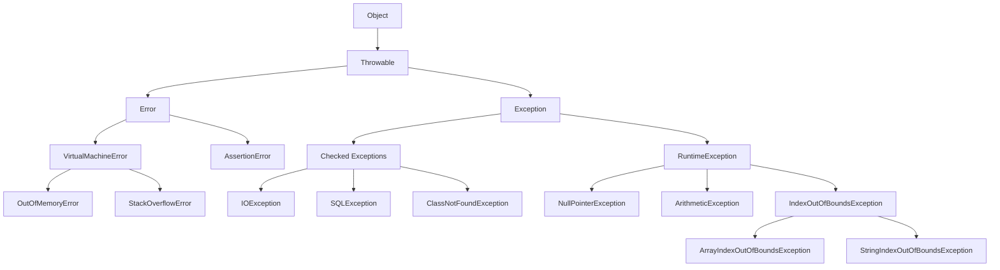
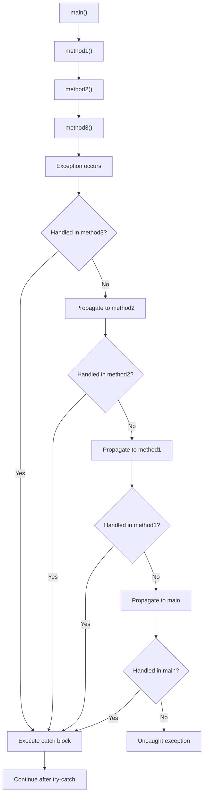

# Exception:
→ Exceptions are always raised at the run time only i.e. while execution.

## Types of Exceptions:
1. Checked Exception / Compile time Exception
→ When our compiler know about the exception i.e. we must handle before executing
→ ClassNotFoundException, FileNotFoundException, IOException, SQLException, 

2. Unchecked Exception


### Note:
→ If any custom exception extends Exception other than RuntimeException will be Checked.
    Hence, the user must handle it before executing the program.


##How to create custom exceptions/user-defined exception:
→ Create a class which extends either Exception or RuntimeException class
→ Add one constructor and pass the message.

Eg.
1. UserAlreadyExistException
2. EmailAlreadyExistException
3. DuplicateProductException
4. DeliveryAreaNotInServiceException
5. MaxQuantityFaultException
6. DuplicateUserException
7. InternalServerException
8. MinQtyFaultException


# Java Exception Handling

## 1. What is Exception Handling?

**Exception Handling** is a mechanism in Java used to handle runtime problems so that the normal flow of program execution can be maintained.

An exception is an unexpected event that occurs during program execution and interrupts the normal flow of instructions.

### Why do we need Exception Handling?

Consider the following example:

```java
public class Driver {
    public static void main(String[] args) {

        System.out.println("Program starts");

        int a = 10;
        int b = 0;

        int result = a / b;

        System.out.println("Result: " + result);
        System.out.println("Program ends");
    }
}
```

**Output:**

```text
Program starts
Exception in thread "main" java.lang.ArithmeticException: / by zero
```

Here:

1. The program starts executing normally.
2. `a / b` attempts to divide 10 by 0.
3. Java generates an `ArithmeticException`.
4. The normal execution of the method is interrupted.
5. The remaining statements in the method are not executed because the exception is unhandled.

Using exception handling, we can handle such situations and control how the program responds.

---

## 2. Understanding Throwable

In Java, **Throwable is the root class of the entire exception-handling hierarchy.**

Both `Error` and `Exception` are direct child classes of `Throwable`.

Whenever an object needs to be thrown using Java's exception mechanism, it must be an instance of `Throwable` or one of its subclasses.

### 2.1 Throwable Hierarchy

```text
                     Object
                        |
                        |
                    Throwable
                   /         \
                  /           \
               Error        Exception
                |               |
                |               |
        VirtualMachineError   IOException
        StackOverflowError    SQLException
        OutOfMemoryError      ClassNotFoundException
                              |
                              |
                        RuntimeException
                              |
               --------------------------------
               |              |               |
          NullPointer     Arithmetic      ArrayIndexOut
          Exception       Exception       OfBoundsException
```

The above diagram is simplified. The actual hierarchy contains additional classes and intermediate subclasses.

### 2.2 Complete Conceptual Flowchart



### 2.3 What is Throwable?

`Throwable` is a class in the `java.lang` package.

It provides methods that are commonly used while handling exceptions.

Important methods:

| Method              | Purpose                                                  |
|---------------------|----------------------------------------------------------|
| `getMessage()`      | Returns the exception message.                           |
| `toString()`        | Returns the exception class name along with its message. |
| `printStackTrace()` | Prints the exception details and stack trace.            |
| `getCause()`        | Returns the cause of the exception, if available.        |
| `getStackTrace()`   | Returns the stack trace elements as an array.            |

Example:

```java
public class Driver {
    public static void main(String[] args) {

        try {
            int result = 10 / 0;
        }
        catch (ArithmeticException e) {

            System.out.println(e.getMessage());

            System.out.println(e.toString());

            e.printStackTrace();
        }
    }
}
```

---

## 3. Difference Between Error and Exception

Both `Error` and `Exception` are child classes of `Throwable`, but they represent different types of problems.

### 3.1 Error

An Error represents a serious problem that generally occurs due to JVM or system-level failures.

These problems are generally not expected to be handled by normal application code.

Examples:

1. `StackOverflowError`
2. `OutOfMemoryError`
3. `VirtualMachineError`
4. `AssertionError`

Example of StackOverflowError:

```java
public class Driver {

    static void display() {
        display();
    }

    public static void main(String[] args) {
        display();
    }
}
```

Here, the method continuously calls itself without a termination condition.

Eventually, the JVM runs out of stack space and throws a `StackOverflowError`.

### 3.2 Exception

An Exception represents a condition that an application may be able to anticipate and handle.

Examples:

1. `NullPointerException`
2. `ArithmeticException`
3. `IOException`
4. `SQLException`
5. `ClassNotFoundException`

Example:

```java
public class Driver {
    public static void main(String[] args) {

        try {
            int result = 10 / 0;
        }
        catch (ArithmeticException e) {
            System.out.println("Cannot divide by zero");
        }
    }
}
```

Here, the exception is caught and handled, allowing the program to continue after the catch block.

### 3.3 Comparison

| Feature      | Error                                     | Exception                               |
|--------------|-------------------------------------------|-----------------------------------------|
| Parent class | Throwable                                 | Throwable                               |
| Nature       | Serious JVM or system-level problem       | Application-level exceptional condition |
| Handling     | Generally not handled by application code | Can often be handled                    |
| Recovery     | Usually difficult                         | Often possible                          |
| Examples     | OutOfMemoryError, StackOverflowError      | IOException, NullPointerException       |

**Important:** Both Error and Exception are technically throwable and can be caught, but catching an Error generally does not solve the underlying problem.

---

## 4. Types of Exceptions

Java exceptions are broadly classified into two categories:

1. Checked Exceptions
2. Unchecked Exceptions

### 4.1 Checked Exceptions

Checked exceptions are exceptions that the compiler checks during compilation.

If a method can throw a checked exception, the caller must either:

- Handle it using `try-catch`, or
- Declare it using `throws` and pass the responsibility to its caller.

Examples:

- IOException
- SQLException
- ClassNotFoundException
- InterruptedException
- FileNotFoundException

Example:

```java
import java.io.FileReader;
import java.io.IOException;

public class Driver {

    public static void main(String[] args) {

        try {
            FileReader reader = new FileReader("data.txt");
            System.out.println("File opened successfully");
            reader.close();
        }
        catch (IOException e) {
            System.out.println("Unable to access file");
        }
    }
}
```

Here, `IOException` is a checked exception.

The compiler requires us to handle or declare it.

### 4.2 Unchecked Exceptions

Unchecked exceptions are exceptions that the compiler does not require us to handle or declare.

They generally occur due to programming mistakes or invalid operations during runtime.

They are subclasses of `RuntimeException`.

Examples:

- NullPointerException
- ArithmeticException
- ArrayIndexOutOfBoundsException
- NumberFormatException
- ClassCastException
- IllegalArgumentException

Example:

```java
public class Driver {

    public static void main(String[] args) {

        String name = null;

        System.out.println(name.length());
    }
}
```

Here, the compiler does not force us to handle the `NullPointerException`.

However, during execution, Java throws the exception because we are calling a method on a null reference.

### 4.3 Checked vs Unchecked Exceptions

| Feature              | Checked Exception                                     | Unchecked Exception                                   |
|----------------------|-------------------------------------------------------|-------------------------------------------------------|
| Checked by           | Compiler                                              | Not enforced by compiler                              |
| Occurs               | During runtime when the exceptional condition happens | During runtime when the exceptional condition happens |
| Handling requirement | Must be caught or declared                            | Not mandatory                                         |
| Parent hierarchy     | Exception, excluding RuntimeException subclasses      | RuntimeException and its subclasses                   |
| Example              | IOException                                           | NullPointerException                                  |

**Important:** Checked and unchecked refer to compile-time handling requirements, not to whether the exception happens at compile time or runtime. Both occur during runtime.

---

## 5. What is Try-Catch?

`try` and `catch` are Java keywords used to handle exceptions.

- `try`: Contains code that may generate an exception.
- `catch`: Contains code that handles the exception.

### Example

```java
public class Driver {

    public static void main(String[] args) {

        System.out.println("Main starts");

        try {
            int a = 10;
            int b = 0;

            int result = a / b;

            System.out.println(result);
        }
        catch (ArithmeticException e) {
            System.out.println("Cannot divide by zero");
        }

        System.out.println("Main ends");
    }
}
```

**Output:**

```text
Main starts
Cannot divide by zero
Main ends
```

### How Does It Work?

1. The program enters the `try` block.
2. Java executes statements one by one.
3. When `10 / 0` is executed, an `ArithmeticException` occurs.
4. The remaining statements inside the `try` block are skipped.
5. Java searches for a matching `catch` block.
6. The matching catch block executes.
7. After the catch block completes, execution continues after the try-catch structure.

### Important Rules

1. A `try` block must be followed by at least one `catch` block or a `finally` block.
2. Multiple catch blocks can be associated with one try block.
3. Once an exception occurs inside a try block, the remaining statements in that try block are skipped.
4. After a matching catch block executes, normal execution continues after the try-catch structure.
5. The catch block must handle the exception type or one of its parent types.

---

## 6. Multiple Catch Blocks

Java allows us to use multiple catch blocks to handle different exceptions separately.

### Example

```java
public class Driver {

    public static void main(String[] args) {

        try {

            String name = null;

            System.out.println(name.length());

            int result = 10 / 0;

        }
        catch (NullPointerException e) {
            System.out.println("Null value encountered");
        }
        catch (ArithmeticException e) {
            System.out.println("Arithmetic problem occurred");
        }
        catch (Exception e) {
            System.out.println("Some other exception occurred");
        }
    }
}
```

**Output:**

```text
Null value encountered
```

**Important:** Only the first catch block executes because the `NullPointerException` occurs first.

The arithmetic statement is never reached.

### Catch Block Ordering Rule

Always place the child exception class before its parent exception class.

**Correct:**

```java
try {
    // Risky code
}
catch (NullPointerException e) {
    // Handle NPE
}
catch (RuntimeException e) {
    // Handle other runtime exceptions
}
catch (Exception e) {
    // Handle other exceptions
}
```

**Incorrect:**

```java
try {
    // Risky code
}
catch (Exception e) {
    // Handle exception
}
catch (NullPointerException e) {
    // Compilation error: unreachable catch block
}
```

**Why?**

Because `Exception` is the parent of `NullPointerException`.

The first catch block can already catch the NPE, making the second catch block unreachable.

---

## 7. What is Finally?

The `finally` block is used to execute important cleanup code.

It generally executes whether an exception occurs or not, provided the JVM continues executing normally.

### Example

```java
public class Driver {

    public static void main(String[] args) {

        try {
            System.out.println("Inside try block");

            int result = 10 / 0;
        }
        catch (ArithmeticException e) {
            System.out.println("Exception handled");
        }
        finally {
            System.out.println("Finally block executed");
        }

        System.out.println("Main ends");
    }
}
```

**Output:**

```text
Inside try block
Exception handled
Finally block executed
Main ends
```

### Important Points About Finally

1. Finally generally executes whether an exception occurs or not.
2. It is commonly used for resource cleanup.
3. It executes after the try and catch blocks.
4. It may not execute if the JVM terminates abruptly, for example through `System.exit()`.
5. Avoid writing `return` or throwing another exception inside finally because it can override an earlier return or exception.

### Example: Finally Executes Even Without an Exception

```java
public class Driver {

    public static void main(String[] args) {

        try {
            System.out.println("Inside try block");
        }
        catch (ArithmeticException e) {
            System.out.println("Exception handled");
        }
        finally {
            System.out.println("Finally executed");
        }

        System.out.println("Main ends");
    }
}
```

**Output:**

```text
Inside try block
Finally executed
Main ends
```

Notice that the finally block executes even though no exception occurred.

---

## 8. What is Exception Propagation?

Exception propagation means passing an exception from one method to its caller when the current method does not handle it.

Consider the following method calls:

```text
main()
  |
  v
method1()
  |
  v
method2()
  |
  v
method3()
```

Suppose an exception occurs inside `method3()`.

If `method3()` does not handle the exception:

1. The exception moves back to `method2()`.
2. If `method2()` does not handle it, it moves back to `method1()`.
3. If `method1()` does not handle it, it moves back to `main()`.
4. If no matching handler is found, the exception remains uncaught and terminates the thread.

### Example

```java
public class Driver {

    public static void main(String[] args) {

        System.out.println("Main starts");

        try {
            method1();
        }
        catch (NullPointerException e) {
            System.out.println("Exception handled in main");
        }

        System.out.println("Main ends");
    }

    static void method1() {

        System.out.println("Method1 starts");

        method2();

        System.out.println("Method1 ends");
    }

    static void method2() {

        System.out.println("Method2 starts");

        method3();

        System.out.println("Method2 ends");
    }

    static void method3() {

        System.out.println("Method3 starts");

        String name = null;

        System.out.println(name.length());

        System.out.println("Method3 ends");
    }
}
```

**Output:**

```text
Main starts
Method1 starts
Method2 starts
Method3 starts
Exception handled in main
Main ends
```

Notice:

- `Method3 ends` is not printed.
- `Method2 ends` is not printed.
- `Method1 ends` is not printed.
- The exception propagates to `main()`.
- The catch block in main handles it.
- Execution continues after the catch block.

### Exception Propagation Flowchart



---

## 9. Difference Between throw and throws

Both `throw` and `throws` are used in exception handling, but their purposes are different.

### 9.1 throw

The `throw` keyword is used to explicitly throw an exception object.

### Example

```java
public class Driver {

    public static void main(String[] args) {

        int age = 15;

        if (age < 18) {
            throw new IllegalArgumentException("Age must be 18 or above");
        }

        System.out.println("Eligible");
    }
}
```

**Output:**

```text
Exception in thread "main" java.lang.IllegalArgumentException: Age must be 18 or above
```

Here, we are manually throwing an `IllegalArgumentException`.

### 9.2 throws

The `throws` keyword is used in a method declaration to declare that the method may pass certain exceptions to its caller.

### Example

```java
import java.io.FileReader;
import java.io.IOException;

public class Driver {

    static void readFile() throws IOException {

        FileReader reader = new FileReader("data.txt");

        reader.close();
    }

    public static void main(String[] args) {

        try {
            readFile();
        }
        catch (IOException e) {
            System.out.println("File handling exception");
        }
    }
}
```

Here:

- `throws IOException` declares the possible checked exception.
- `readFile()` does not handle the exception itself.
- The caller, `main()`, handles it using try-catch.

### 9.3 Comparison

| Feature     | throw                                     | throws                               |
|-------------|-------------------------------------------|--------------------------------------|
| Purpose     | Explicitly throws an exception            | Declares possible exceptions         |
| Usage       | Inside a method or block                  | In method declaration                |
| Followed by | Exception object                          | Exception class names                |
| Number      | Throws one exception object per statement | Can declare multiple exception types |
| Example     | `throw new IOException();`                | `void read() throws IOException`     |

---

## 10. What is Stack Trace?

A stack trace shows the sequence of method calls that were active when an exception occurred.

It helps developers identify:

- Which exception occurred.
- Where the exception occurred.
- Which method called the method where the exception occurred.
- How the exception propagated through the application.

### Example

```java
public class Driver {

    public static void main(String[] args) {

        try {
            String name = null;
            System.out.println(name.length());
        }
        catch (NullPointerException e) {
            e.printStackTrace();
        }
    }
}
```

**Example stack trace:**

```text
java.lang.NullPointerException
    at Driver.main(Driver.java:7)
```

### Important Stack Trace Methods

```java
e.getMessage();
e.toString();
e.printStackTrace();
e.getCause();
```

**Note:** By default, `printStackTrace()` prints to `System.err`, whereas `System.out.println()` prints to `System.out`.

---

## 11. What is Custom Exception?

Java allows developers to create their own exception classes according to application requirements.

These are called Custom Exceptions or User-Defined Exceptions.

There are two common ways to create them:

1. Extend `Exception` to create a checked custom exception.
2. Extend `RuntimeException` to create an unchecked custom exception.

### Example: Custom Checked Exception

```java
class InvalidAgeException extends Exception {

    InvalidAgeException(String message) {
        super(message);
    }
}

public class Driver {

    public static void main(String[] args) {

        int age = 15;

        try {

            if (age < 18) {
                throw new InvalidAgeException("Age must be 18 or above");
            }

            System.out.println("Eligible for registration");

        }
        catch (InvalidAgeException e) {
            System.out.println(e.getMessage());
        }
    }
}
```

**Output:**

```text
Age must be 18 or above
```

Here:

- `InvalidAgeException` is our custom exception.
- It extends `Exception`, so it is checked.
- We explicitly throw it using `throw`.
- We handle it using `catch`.

---

## 12. Try-With-Resources

Try-with-resources was introduced in Java 7.

It is used to automatically close resources after their use.

Resources must implement `AutoCloseable` (or its subinterface `Closeable`).

### Example

```java
import java.io.FileReader;
import java.io.IOException;

public class Driver {

    public static void main(String[] args) {

        try (FileReader reader = new FileReader("data.txt")) {

            System.out.println("File opened successfully");

        }
        catch (IOException e) {
            System.out.println("File operation failed");
        }
    }
}
```

Here, Java automatically closes the `FileReader` after the try block completes, whether normally or exceptionally.

This reduces the need for manually closing resources inside a finally block.

---

## 13. Important Exception Handling Rules

1. `Throwable` is the root class of Java's exception hierarchy.
2. `Error` and `Exception` are direct subclasses of `Throwable`.
3. `RuntimeException` is a subclass of `Exception`.
4. Checked exceptions are checked by the compiler.
5. Unchecked exceptions are not required to be caught or declared.
6. An exception interrupts the normal execution flow of the current method.
7. Exception propagation moves an unhandled exception towards the caller.
8. A matching catch block handles the exception.
9. Statements after the point where an exception occurs inside the try block are skipped.
10. Statements after a successfully completed try-catch structure execute normally.
11. Multiple catch blocks can be used to handle different exception types.
12. A child exception must be caught before its parent exception.
13. The finally block generally executes whether an exception occurs or not.
14. `throw` explicitly throws an exception object.
15. `throws` declares possible exceptions in a method signature.
16. Custom exceptions can be created by extending `Exception` or `RuntimeException`.
17. `printStackTrace()` helps identify the origin and propagation path of an exception.
18. Try-with-resources automatically closes supported resources.

---

## 14. Quick Revision

| Concept               | Meaning                                                     |
|-----------------------|-------------------------------------------------------------|
| Throwable             | Root class of the exception hierarchy                       |
| Error                 | Serious JVM or system-level problem                         |
| Exception             | Exceptional condition that application code may handle      |
| Checked Exception     | Compiler requires handling or declaration                   |
| Unchecked Exception   | Compiler does not require handling or declaration           |
| try                   | Contains code that may throw an exception                   |
| catch                 | Handles an exception                                        |
| finally               | Used for cleanup operations                                 |
| throw                 | Explicitly throws an exception object                       |
| throws                | Declares possible exceptions in a method signature          |
| Exception Propagation | Passing an unhandled exception to the caller                |
| Stack Trace           | Shows the method-call sequence associated with an exception |
| Custom Exception      | Exception created by the developer                          |
| Try-With-Resources    | Automatically closes supported resources                    |

---

## 15. Conclusion

Exception Handling is an important Java concept that helps developers manage unexpected situations during program execution.

The `Throwable` class is the root of the exception hierarchy, with `Error` and `Exception` as its direct subclasses.

By understanding checked exceptions, unchecked exceptions, try-catch-finally, throw, throws and exception propagation, we can write more reliable and maintainable Java applications.