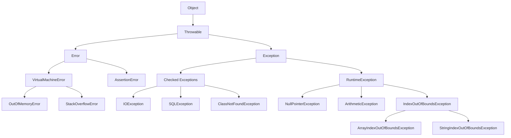

# Exception:
→ Exceptions are always raised at the run time only i.e. while execution.

## Types of Exceptions:
1. Checked Exception / Compile time Exception
→ When our compiler know about the exception i.e. we must handle before executing
→ ClassNotFoundException, FileNotFoundException, IOException, SQLException, 

2. Unchecked Exception


### Note:
→ If any custom exception extends Exception other than RuntimeException will be Checked.
    Hence the user must handle it before executing the program.


##How to create custom exceptions/user-defined exception:
→ Create a class which extends either Exception or RuntimeException class
→ Add one constructor and pass the message.

Eg.
1. UserAlreadyExistException
2. EmailAlreadyExistException
3. DuplicateProductException
4. DeliveryAreaNotInServiceException
5. MaxQuantityFaultException
6. DuplicateUserException
7. InternalServerException
8. MinQtyFaultException


# Java Exception Handling

## 1. What is Exception Handling?

**Exception Handling** is a mechanism in Java used to handle runtime problems so that the normal flow of program execution can be maintained.

An exception is an unexpected event that occurs during program execution and interrupts the normal flow of instructions.

### Why do we need Exception Handling?

Consider the following example:

```java
public class Driver {
    public static void main(String[] args) {

        System.out.println("Program starts");

        int a = 10;
        int b = 0;

        int result = a / b;

        System.out.println("Result: " + result);
        System.out.println("Program ends");
    }
}
```

**Output:**

```text
Program starts
Exception in thread "main" java.lang.ArithmeticException: / by zero
```

Here:

1. The program starts executing normally.
2. `a / b` attempts to divide 10 by 0.
3. Java generates an `ArithmeticException`.
4. The normal execution of the method is interrupted.
5. The remaining statements in the method are not executed because the exception is unhandled.

Using exception handling, we can handle such situations and control how the program responds.

---

## 2. Understanding Throwable

In Java, **Throwable is the root class of the entire exception-handling hierarchy.**

Both `Error` and `Exception` are direct child classes of `Throwable`.

Whenever an object needs to be thrown using Java's exception mechanism, it must be an instance of `Throwable` or one of its subclasses.

### 2.1 Throwable Hierarchy

```text
                     Object
                        |
                        |
                    Throwable
                   /         \
                  /           \
               Error        Exception
                |               |
                |               |
        VirtualMachineError   IOException
        StackOverflowError    SQLException
        OutOfMemoryError      ClassNotFoundException
                              |
                              |
                        RuntimeException
                              |
               --------------------------------
               |              |               |
          NullPointer     Arithmetic      ArrayIndexOut
          Exception       Exception       OfBoundsException
```

The above diagram is simplified. The actual hierarchy contains additional classes and intermediate subclasses.

### 2.2 Complete Conceptual Flowchart



### 2.3 What is Throwable?

`Throwable` is a class in the `java.lang` package.

It provides methods that are commonly used while handling exceptions.

Important methods:

| Method              | Purpose                                                  |
|---------------------|----------------------------------------------------------|
| `getMessage()`      | Returns the exception message.                           |
| `toString()`        | Returns the exception class name along with its message. |
| `printStackTrace()` | Prints the exception details and stack trace.            |
| `getCause()`        | Returns the cause of the exception, if available.        |
| `getStackTrace()`   | Returns the stack trace elements as an array.            |

Example:

```java
public class Driver {
    public static void main(String[] args) {

        try {
            int result = 10 / 0;
        }
        catch (ArithmeticException e) {

            System.out.println(e.getMessage());

            System.out.println(e.toString());

            e.printStackTrace();
        }
    }
}
```

---

## 3. Difference Between Error and Exception

Both `Error` and `Exception` are child classes of `Throwable`, but they represent different types of problems.

### 3.1 Error

An Error represents a serious problem that generally occurs due to JVM or system-level failures.

These problems are generally not expected to be handled by normal application code.

Examples:

1. `StackOverflowError`
2. `OutOfMemoryError`
3. `VirtualMachineError`
4. `AssertionError`

Example of StackOverflowError:

```java
public class Driver {

    static void display() {
        display();
    }

    public static void main(String[] args) {
        display();
    }
}
```

Here, the method continuously calls itself without a termination condition.

Eventually, the JVM runs out of stack space and throws a `StackOverflowError`.

### 3.2 Exception

An Exception represents a condition that an application may be able to anticipate and handle.

Examples:

1. `NullPointerException`
2. `ArithmeticException`
3. `IOException`
4. `SQLException`
5. `ClassNotFoundException`

Example:

```java
public class Driver {
    public static void main(String[] args) {

        try {
            int result = 10 / 0;
        }
        catch (ArithmeticException e) {
            System.out.println("Cannot divide by zero");
        }
    }
}
```

Here, the exception is caught and handled, allowing the program to continue after the catch block.

### 3.3 Comparison

| Feature      | Error                                     | Exception                               |
|--------------|-------------------------------------------|-----------------------------------------|
| Parent class | Throwable                                 | Throwable                               |
| Nature       | Serious JVM or system-level problem       | Application-level exceptional condition |
| Handling     | Generally not handled by application code | Can often be handled                    |
| Recovery     | Usually difficult                         | Often possible                          |
| Examples     | OutOfMemoryError, StackOverflowError      | IOException, NullPointerException       |

**Important:** Both Error and Exception are technically throwable and can be caught, but catching an Error generally does not solve the underlying problem.

---

## 4. Types of Exceptions

Java exceptions are broadly classified into two categories:

1. Checked Exceptions
2. Unchecked Exceptions

### 4.1 Checked Exceptions

Checked exceptions are exceptions that the compiler checks during compilation.

If a method can throw a checked exception, the caller must either:

- Handle it using `try-catch`, or
- Declare it using `throws` and pass the responsibility to its caller.

Examples:

- IOException
- SQLException
- ClassNotFoundException
- InterruptedException
- FileNotFoundException

Example:

```java
import java.io.FileReader;
import java.io.IOException;

public class Driver {

    public static void main(String[] args) {

        try {
            FileReader reader = new FileReader("data.txt");
            System.out.println("File opened successfully");
            reader.close();
        }
        catch (IOException e) {
            System.out.println("Unable to access file");
        }
    }
}
```

Here, `IOException` is a checked exception.

The compiler requires us to handle or declare it.

### 4.2 Unchecked Exceptions

Unchecked exceptions are exceptions that the compiler does not require us to handle or declare.

They generally occur due to programming mistakes or invalid operations during runtime.

They are subclasses of `RuntimeException`.

Examples:

- NullPointerException
- ArithmeticException
- ArrayIndexOutOfBoundsException
- NumberFormatException
- ClassCastException
- IllegalArgumentException

Example:

```java
public class Driver {

    public static void main(String[] args) {

        String name = null;

        System.out.println(name.length());
    }
}
```

Here, the compiler does not force us to handle the `NullPointerException`.

However, during execution, Java throws the exception because we are calling a method on a null reference.

### 4.3 Checked vs Unchecked Exceptions

| Feature              | Checked Exception                                     | Unchecked Exception                                   |
|----------------------|-------------------------------------------------------|-------------------------------------------------------|
| Checked by           | Compiler                                              | Not enforced by compiler                              |
| Occurs               | During runtime when the exceptional condition happens | During runtime when the exceptional condition happens |
| Handling requirement | Must be caught or declared                            | Not mandatory                                         |
| Parent hierarchy     | Exception, excluding RuntimeException subclasses      | RuntimeException and its subclasses                   |
| Example              | IOException                                           | NullPointerException                                  |

**Important:** Checked and unchecked refer to compile-time handling requirements, not to whether the exception happens at compile time or runtime. Both occur during runtime.

---

## 5. What is Try-Catch?

`try` and `catch` are Java keywords used to handle exceptions.

- `try`: Contains code that may generate an exception.
- `catch`: Contains code that handles the exception.

### Example

```java
public class Driver {

    public static void main(String[] args) {

        System.out.println("Main starts");

        try {
            int a = 10;
           
